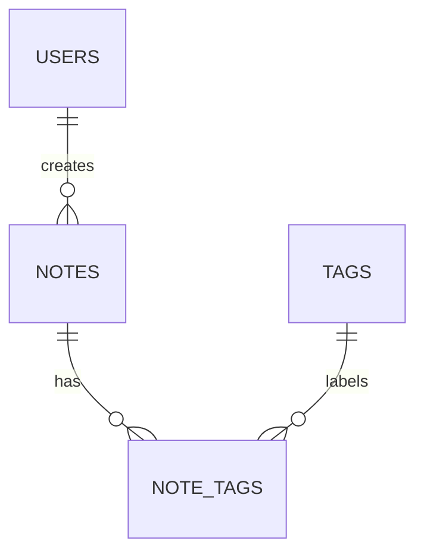

# QuickNotes Database Design

## Entities and Columns

| Table | Columns and SQLite types |
| --- | --- |
| `users` | `id INTEGER PRIMARY KEY`; `name TEXT NOT NULL`; `email TEXT NOT NULL UNIQUE` |
| `notes` | `id INTEGER PRIMARY KEY`; `user_id INTEGER NOT NULL` (FK to `users.id`); `text TEXT NOT NULL`; `created_at TEXT NOT NULL` (ISO 8601 timestamp) |
| `tags` | `id INTEGER PRIMARY KEY`; `name TEXT NOT NULL UNIQUE` |
| `note_tags` | `note_id INTEGER NOT NULL` (FK to `notes.id`); `tag_id INTEGER NOT NULL` (FK to `tags.id`); composite `PRIMARY KEY (note_id, tag_id)` |

## Relationships

One user can create many notes, while each note belongs to one user. Notes and tags have a many-to-many relationship: one note can have several tags, and one tag can label several notes. `note_tags` is the join table that connects each note-tag pair. Its composite primary key prevents attaching the same tag to the same note more than once. The foreign keys use `ON DELETE CASCADE` so dependent notes or links are removed with their parent record.

## Indexes

`idx_notes_user_created_at` indexes `notes(user_id, created_at DESC)`. It supports finding one user's notes in newest-first order and helps group notes by user. `idx_note_tags_tag_id` indexes `(tag_id, note_id)` so SQLite can quickly find notes for a tag such as `urgent`; the join table's primary key already supports lookups starting from `note_id`. The unique email and tag-name constraints create their own indexes.

## Running the SQL

Run `quicknotes.sql` in order in an SQLite playground. It creates all four tables, inserts example data, and then runs the three requested queries. The sample includes Amina's two notes, one urgent note, and Kendi with no notes so the `LEFT JOIN` count returns zero for that user.